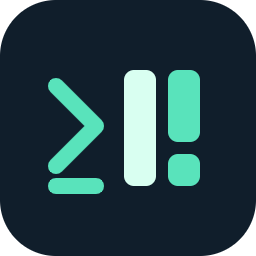
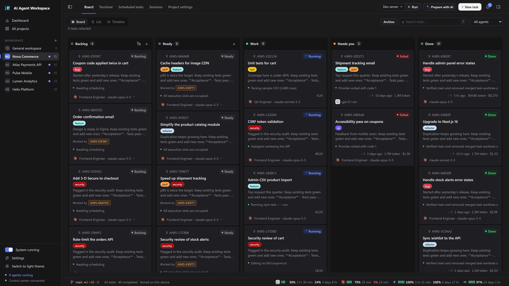
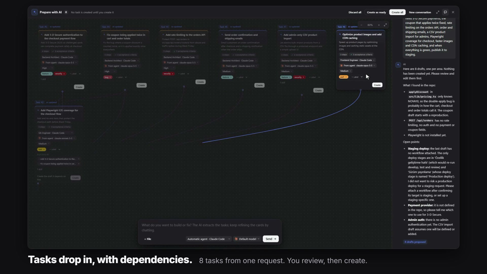
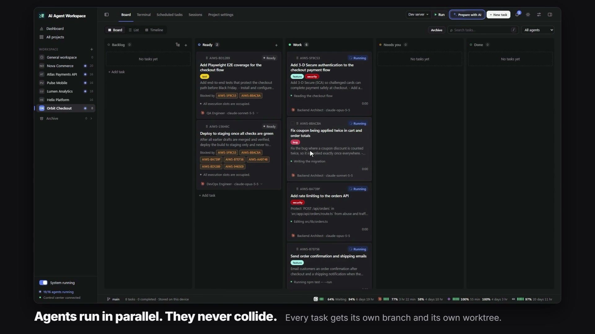
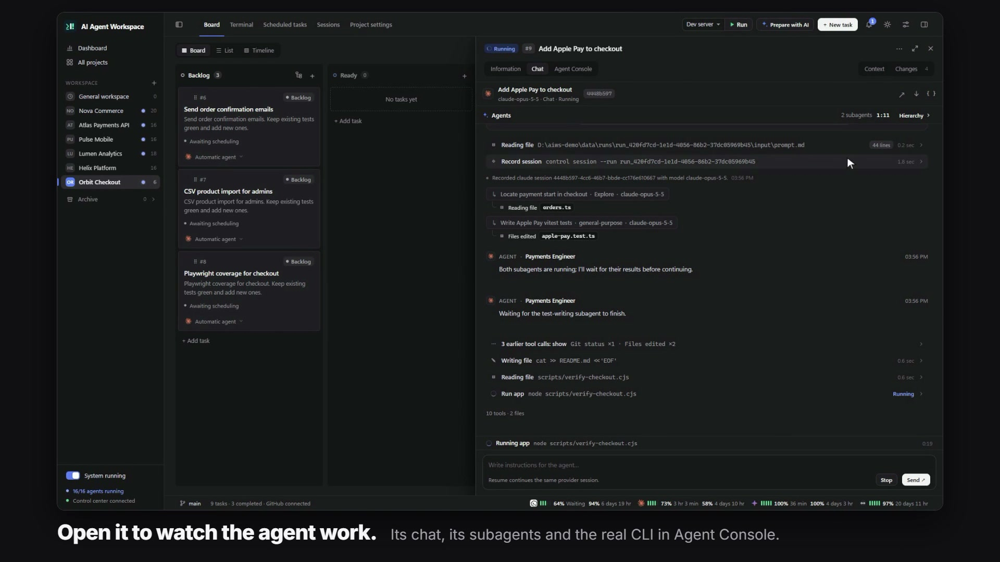
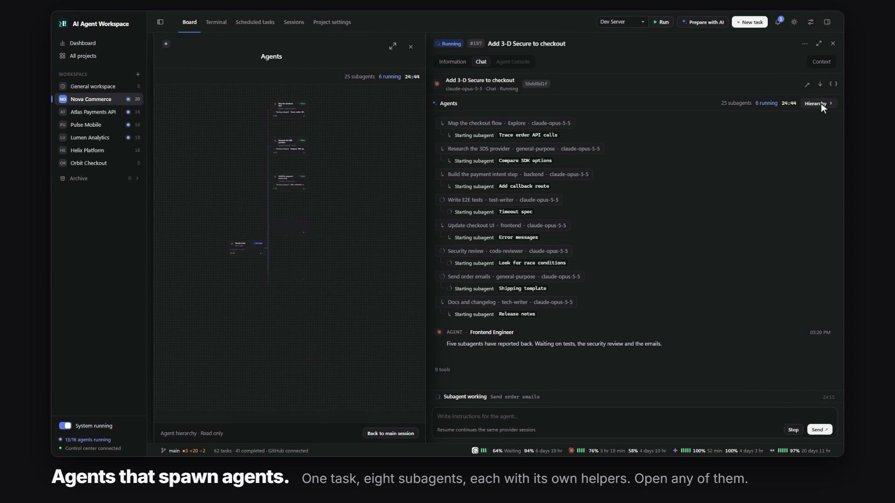
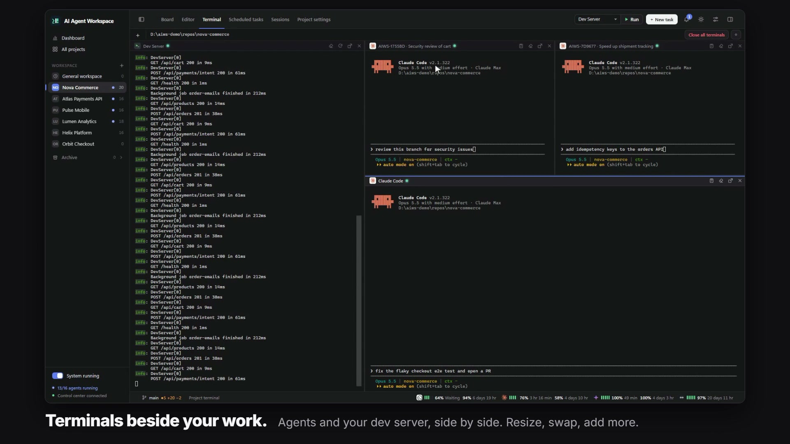
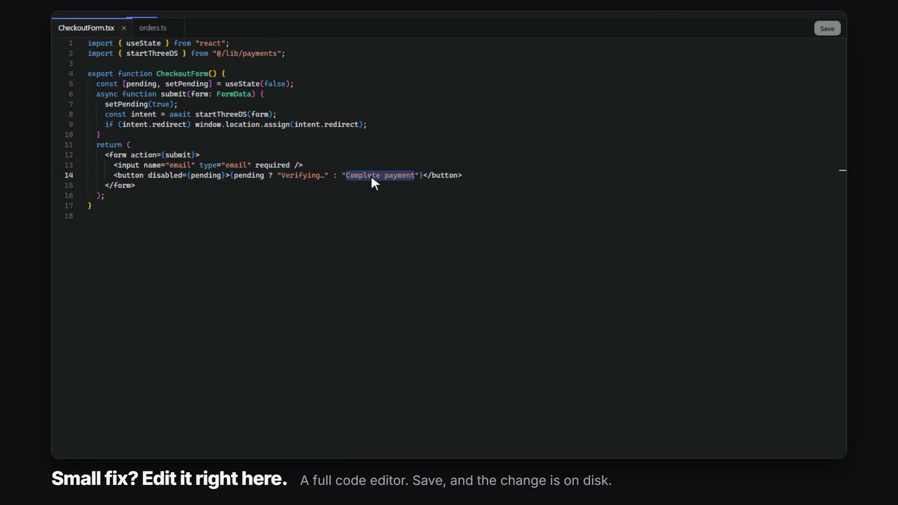
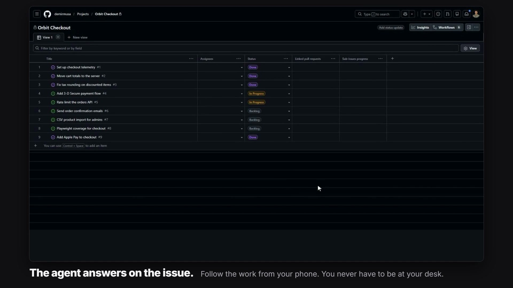
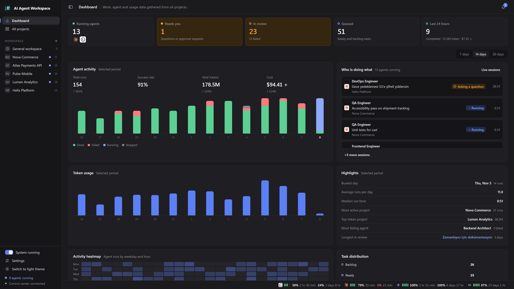

<div align="center">



# AI Agent Workspace

**All your coding agents in one place.**

A local-first Kanban board and desktop app that runs Claude Code, Codex and other coding agents in parallel,<br>
each task in its own Git branch and worktree, and merges the result for you.

[](LICENSE)


[Quick start](#quick-start) · [Features](#features) · [Documentation](https://github.com/demirmusa/ai-agent-workspace/wiki) · [Plugins](https://github.com/demirmusa/ai-agent-workspace/wiki/Plugins-and-Themes)

</div>

https://github.com/user-attachments/assets/0192f416-2aa2-451e-bb12-352fbd436df7

## What is it?

AI Agent Workspace (AIWS) is a control center for the coding agents you already use. You describe the work, it
becomes cards on a board, and agents pick the cards up on your own machine: in parallel, each one isolated in its
own branch and worktree. When a task passes, AIWS merges it into your main branch and cleans up after itself.

- **Local first.** Projects, tasks and history are stored on your device. No account and no cloud service are required.
- **Uses your existing agent CLIs.** Claude Code, Codex, OpenCode, Antigravity and GitHub Copilot run with the logins
  and subscriptions you already have.
- **GitHub is optional.** Connect a project to GitHub Projects and you can add work from your phone; the agent
  answers on the issue.



## Quick start

You need [Node.js 22.13 or newer](https://nodejs.org/), [Git](https://git-scm.com/), and at least one agent CLI
installed and signed in (for example [Claude Code](https://code.claude.com/docs) or
[Codex](https://developers.openai.com/codex/cli)).

### Windows

```powershell
git clone https://github.com/demirmusa/ai-agent-workspace.git
cd ai-agent-workspace
.\run.ps1
```

That is the whole installation. `run.ps1` installs the dependencies, links the `aiws` command, builds the project
and opens the desktop app. Run it again any time you pull a new version.

> If PowerShell blocks the script, run `powershell -ExecutionPolicy Bypass -File .\run.ps1` instead.

### macOS and Linux

```bash
git clone https://github.com/demirmusa/ai-agent-workspace.git
cd ai-agent-workspace/src
npm install
npm link          # makes the aiws command available to agents
npm run desktop   # downloads Electron on first run, builds, opens the app
```

### Your first task

1. Click **+** next to **Workspace** (**New project**) and pick the folder of a project you want agents to work on.
2. Click **New task**, describe what you want, and create it. Or click **Prepare with AI**, explain the goal in
   your own words, and let it split the work into tasks.
3. Move the card to **Ready**. An agent starts on its own; click the card to watch it work, answer its questions
   and review the changes.

Prefer the browser over the desktop app? Run `npm run build` and `npm run control` in `src`, then open
<http://127.0.0.1:4317>. More options are in the [installation guide](https://github.com/demirmusa/ai-agent-workspace/wiki/Installation).

## Features

<table>
<tr>
<td width="50%" valign="top">

**Just say what you need**

Describe the work once. *Prepare with AI* turns it into focused tasks with dependencies; you review them and create.


</td>
<td width="50%" valign="top">

**Agents run in parallel and never collide**

Every task gets its own branch and worktree. Tasks that wait on another task start only after it is merged.


</td>
</tr>
<tr>
<td valign="top">

**Watch any agent work**

Open a card to read the chat, follow tool calls and diffs, or drop into the real CLI in Agent Console.


</td>
<td valign="top">

**Agents that spawn agents**

Subagents and their own helpers appear as a live tree. Open any of them to see exactly what it did.


</td>
</tr>
<tr>
<td valign="top">

**Terminals beside your work**

Agent CLIs, shells and your dev server side by side. Resize, swap, add more; sessions survive a page reload.


</td>
<td valign="top">

**Files, editor and Git built in**

A file tree with live Git changes, a full code editor for small fixes, and a Git panel for branches and worktrees.


</td>
</tr>
<tr>
<td valign="top">

**Add work from GitHub, from anywhere**

Open an issue on your GitHub Project and set it to Ready. An agent on your machine takes it and replies on the issue.


</td>
<td valign="top">

**Every run, token and dollar**

A dashboard across all projects and agents: runs, success rate, token usage, cost and who is doing what right now.


</td>
</tr>
</table>

And more:

- **Reusable agents, skills and workflows.** Define agents with instructions, context and skill packages, start from
  163 community templates, and chain agents into multi-stage workflows.
- **Scheduled and recurring tasks.** Run work once at a set time, every day, on chosen weekdays, monthly or by cron.
- **Questions and approvals.** Agents ask you through one channel; you get a notification and answer in the task.
- **Session history.** Browse, resume or convert your existing Claude Code and Codex sessions, and move a
  conversation from one provider to another.
- **Usage at a glance.** Remaining short-term and weekly quota for your providers in the status bar.
- **Plugins and themes.** Add pages, menu items, task fields, server routes and color themes.
- **Voice dictation, light and dark themes, English and Turkish UI.**
- **A full CLI.** Everything in the app is available through `aiws control`, so agents can manage projects too.

## Supported agents

| Provider | CLI | Notes |
| --- | --- | --- |
| Claude Code | `claude` | Multiple accounts supported |
| Codex | `codex` | |
| OpenCode | `opencode` | |
| Antigravity | `agy` | |
| GitHub Copilot | `copilot` | |
| Custom command | any executable | Run your own script as a task |

AIWS starts the CLI that is installed on your machine, under your account. It does not include or resell model access.

## How it works

```text
 Desktop app or browser            aiws control CLI
            \                         /
             v                       v
        Control server  (127.0.0.1, your machine)
          |           |                 |
   SQLite data    agent CLIs        GitHub (optional)
  (~/.aiws)     in Git worktrees    Projects, issues, PRs
```

The desktop app starts a local server that owns your data, launches agent processes in real terminals, prepares a
worktree per task, and delivers the result by merging the branch or opening a pull request.

## Documentation

The full guide lives in the **[wiki](https://github.com/demirmusa/ai-agent-workspace/wiki)**:

| Start here | Use it | Go deeper |
| --- | --- | --- |
| [Installation](https://github.com/demirmusa/ai-agent-workspace/wiki/Installation) | [Board and tasks](https://github.com/demirmusa/ai-agent-workspace/wiki/Board-and-Tasks) | [CLI reference](https://github.com/demirmusa/ai-agent-workspace/wiki/CLI-Reference) |
| [Quick start](https://github.com/demirmusa/ai-agent-workspace/wiki/Quick-Start) | [Planning with AI](https://github.com/demirmusa/ai-agent-workspace/wiki/Planning-with-AI) | [HTTP API](https://github.com/demirmusa/ai-agent-workspace/wiki/HTTP-API) |
| [Core concepts](https://github.com/demirmusa/ai-agent-workspace/wiki/Core-Concepts) | [Agents, skills and workflows](https://github.com/demirmusa/ai-agent-workspace/wiki/Agents-Skills-and-Workflows) | [Configuration](https://github.com/demirmusa/ai-agent-workspace/wiki/Configuration) |
| [AI providers](https://github.com/demirmusa/ai-agent-workspace/wiki/AI-Providers) | [Agent Console and sessions](https://github.com/demirmusa/ai-agent-workspace/wiki/Agent-Console-and-Sessions) | [Docker deployment](https://github.com/demirmusa/ai-agent-workspace/wiki/Docker-Deployment) |
| [FAQ](https://github.com/demirmusa/ai-agent-workspace/wiki/FAQ) | [Git, worktrees and merging](https://github.com/demirmusa/ai-agent-workspace/wiki/Git-Worktrees-and-Merging) | [Plugins and themes](https://github.com/demirmusa/ai-agent-workspace/wiki/Plugins-and-Themes) |
| [Troubleshooting](https://github.com/demirmusa/ai-agent-workspace/wiki/Troubleshooting) | [GitHub integration](https://github.com/demirmusa/ai-agent-workspace/wiki/GitHub-Integration) | [Security](https://github.com/demirmusa/ai-agent-workspace/wiki/Security) |

## Security

Agents run on your machine with your account's permissions, and the control server can read files and run commands
in your projects. It listens on `127.0.0.1` by default; exposing it to a network requires an access token. Only run
tasks and install plugins you trust. Details: [Security](https://github.com/demirmusa/ai-agent-workspace/wiki/Security).

## Contributing

The application lives in `src/`. Start with the
[development guide](https://github.com/demirmusa/ai-agent-workspace/wiki/Development); the repository rules for both
people and agents are in [AGENTS.md](AGENTS.md).

```bash
cd src
npm install
npm run typecheck
npm test
```

## License

[MIT](LICENSE). Agent templates are from
[VoltAgent/awesome-claude-code-subagents](https://github.com/VoltAgent/awesome-claude-code-subagents) (MIT).
Provider names and logos belong to their owners; this project is not affiliated with them.
