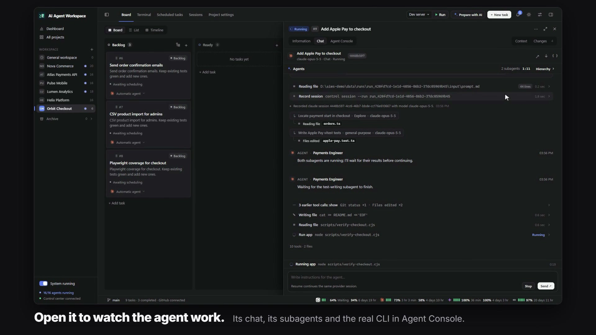
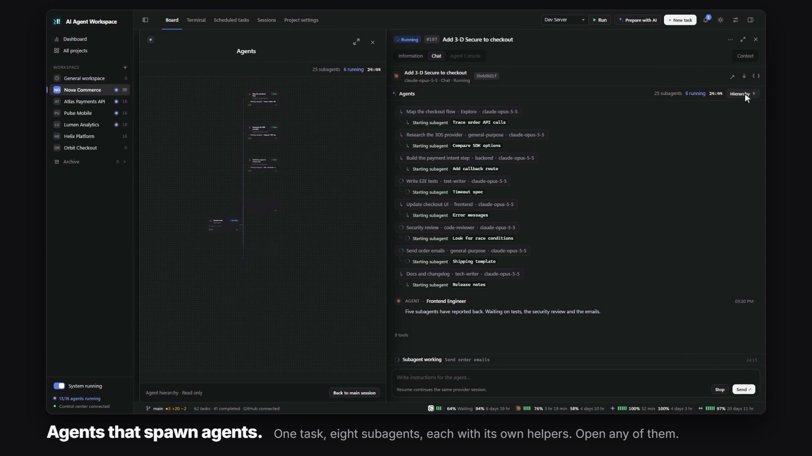

Every task opens in a side panel where you can read what the agent is doing, talk to it, answer its questions and open the real CLI it runs in. The same panel is used for past Codex and Claude Code sessions and for sessions started outside AIWS.



## The task panel

Click a card to open the panel on the right. It takes about 45% of the window by default; drag its left edge to resize (the width is remembered in this browser), or switch it to full screen.

| Tab | What it shows |
|---|---|
| **Chat** | The default tab. Readable agent messages, tool calls (command, output, exit code), file changes and subagents. Type a new instruction at the bottom. |
| **Agent Console** | The real provider CLI of the same run, in an xterm.js terminal. Available only for runs started by AIWS in terminal (PTY) mode. |
| **Information** | Task description, status, runs, sessions and task actions. |

Switching tabs never starts a new provider process and keeps your unsent draft and the open terminal.

The console follows new output by default. Scroll up and following stops; a button at the bottom takes you back to the latest output. The model's private reasoning is never shown, only what the CLI publishes: messages, tool events, errors and output.

### Stream and terminal mode

A task runs in one of two modes:

- **Terminal (PTY)**: the real Codex, Claude Code or OpenCode TUI in a pseudo-terminal (ConPTY on Windows). Your keystrokes go to the CLI. This is what new Codex and Claude tasks use from the UI.
- **Stream**: the provider's non-interactive JSON output, rendered as chat. The run completes on its own.

The mode of a running task cannot be changed. A PTY run ends when the agent calls `aiws control complete`, or when you complete it from the UI.

## Controlling a run

| Action | What actually happens |
|---|---|
| **Stop** | Kills the native process tree, or removes the container in Docker mode. The task becomes cancelled. |
| **Pause**, Linux and macOS native | `SIGSTOP` to the process group; resume sends `SIGCONT`. |
| **Pause**, Docker | `docker pause`, then `docker unpause`. |
| **Pause**, Windows native | The process tree is closed. Resume starts a new provider turn with the saved output and instructions; workspace changes are kept, process memory is not. |
| Send instruction, stream | Queued and applied in a follow-up turn after the current one finishes. |
| Send instruction, PTY | Typed into the real terminal's stdin. |

Tasks with a failed, interrupted or stopped run show **Restart**: a new run in the same workspace with the same settings. Earlier runs and their output are kept. In a workflow only the failed stage is retried.

```powershell
aiws control runs pause run_ID
aiws control runs resume run_ID
aiws control runs send run_ID 'Look at the failing test first, then fix it.'
aiws control runs stop run_ID
aiws control runs events run_ID
```

## Questions and approvals

Agents ask you through the control API instead of guessing. Each run receives `AIWS_RUN_ID`, `AIWS_TASK_ID` and `AIWS_CONTROL_URL`, so the agent can run:

```bash
aiws control ask 'Should the API response stay backward compatible?'
aiws control ask 'Do you approve this operation?' --approval
```

The command blocks until you answer (default limit 86400 seconds; `--no-wait` returns immediately). The task moves to **Needs you**. Approval requests are marked **Your approval is needed**.

Where a pending request shows up:

- The **Notifications** menu in the top bar, across all projects, with a badge and a toast.
- An operating system notification in the desktop app; clicking it opens the request. In the browser, choose **Enable desktop notifications**.
- On the linked GitHub issue, if the project is connected. A comment there answers the question. See [GitHub Integration](GitHub-Integration).

When a native CLI shows its own permission menu ("Would you like to run ... Yes, proceed"), AIWS detects it and offers **Reply in terminal →**. It never approves on your behalf. This text detection is best effort; `aiws control ask` is the reliable channel.

```powershell
aiws control questions list
aiws control questions answer question_ID 'Version 2; keep existing v1 clients working.'
```

## Subagents and the hierarchy

The console shows the provider's real subagents (Codex and Claude Code) as a tree: main agent, children and verified nested children, each with its state. Finished subagents are grouped separately. When the provider's records do not prove who the parent is, the row is marked **Parent agent could not be verified** instead of inventing a link.



- **Hierarchy** opens the tree as a canvas: cards show provider, model, state, last step and duration. Scroll to zoom, drag to pan, double-click to fit.
- Clicking a subagent opens its own transcript in a second, read-only panel next to the main one.
- **Context** opens the **Context window** view, which breaks down what currently fills an agent's context.

Subagent views are read-only: they never send input to the main terminal. Discovery is bounded (128 agents, 16 levels) and is not implemented for OpenCode.

## When an agent runs out of tokens

If the provider reports a usage limit, the console asks whether another agent should continue. **Continue with another agent** in the task menu opens the same choice at any time. The new agent works on the same task, worktree and branch.

| Mode | The new agent receives |
|---|---|
| New clean agent (default) | The task prompt, the previous agent's last messages and a summary of `git status`, commits and diff. |
| Copy the whole session | The previous agent's whole accessible conversation. |

The default is a project setting. When several agents have worked on one task, an **Agent sessions** list appears above the console; earlier agents open read-only.

If a PTY run stops on a connection error, AIWS checks that the provider is reachable and asks the agent to continue. With no connection the task waits and retries every 15 seconds. After 5 failed attempts in 10 minutes the run is marked failed.

## Continuing a finished task

A finished task has no "run again" button. Type a new instruction in **Chat** and send it: AIWS resumes the same verified provider session (`codex resume`, `claude --resume`) in the same workspace. Only your new instruction is sent; the old description is not replayed.

If the session cannot be verified or resumed, AIWS does not silently start a new conversation. You get two explicit options:

- **New session with history** creates a separate task in the same project and carries the accessible messages, tool records and answered questions into a new session. Use it to restart from scratch or to move a conversation between Codex and Claude. The source task stays untouched. Transfers above 2 million characters fail instead of being cut.
- **Fork** in the task header creates an independent Backlog task that carries the history; you start it separately.

Tasks in review or done can also be dragged back to **Ready**; AIWS verifies and resumes the existing session, and asks for confirmation (**Restart with history**) if it cannot.

## Project sessions

The **Sessions** tab of a project lists the Codex and Claude Code sessions that already exist on this machine for exactly that project folder. It reads the providers' local JSONL history (`~/.codex`, `~/.claude`, or `CODEX_HOME` / `CLAUDE_CONFIG_DIR`) read-only. Auth and config files are not read.

- Search runs on the server over title, first user message and session UUID. Filter by provider, sort by recent, oldest or start time. `/` focuses the search box.
- **Open** shows the session in the same panel. Nothing is created or started.
- **Continue session** starts a new AIWS run on the original session UUID, after a confirmation.
- **Convert to task** turns one session into a board card.
- **Import tasks from history** adds a card for every root session of the project. Sessions with proof of completion land in Done. Re-running it does not create duplicates.

```powershell
aiws control projects sessions project_ID --provider codex --refresh
aiws control projects sessions project_ID --search 'login error' --sort oldest
aiws control projects resume project_ID hist_OPAQUE_ID --terminal pty
```

## Live sessions started outside AIWS

**All projects → Live sessions** also lists Codex and Claude Code sessions you started yourself in a normal terminal on the same machine. AIWS proves that the process is alive from the operating system; a recent file alone does not count.

These sessions are read-only: you can follow the conversation and the subagent tree, but AIWS does not attach to that terminal, send input or start a second provider. Type your commands in the terminal that owns the session.

## Limits

- History reading is paginated and bounded; cut or damaged records are shown as warnings.
- System and developer prompts, reasoning blocks and provider metadata are never shown.
- Resuming a host session from a Docker worker is not supported.
- The event log keeps 20000 records; very long provider output can be truncated.

## Related pages

- [Board and Tasks](Board-and-Tasks)
- [Terminals, Files and Voice](Terminals-Files-and-Voice)
- [AI Providers](AI-Providers)
- [GitHub Integration](GitHub-Integration)
- [CLI Reference](CLI-Reference)
- [Troubleshooting](Troubleshooting)
