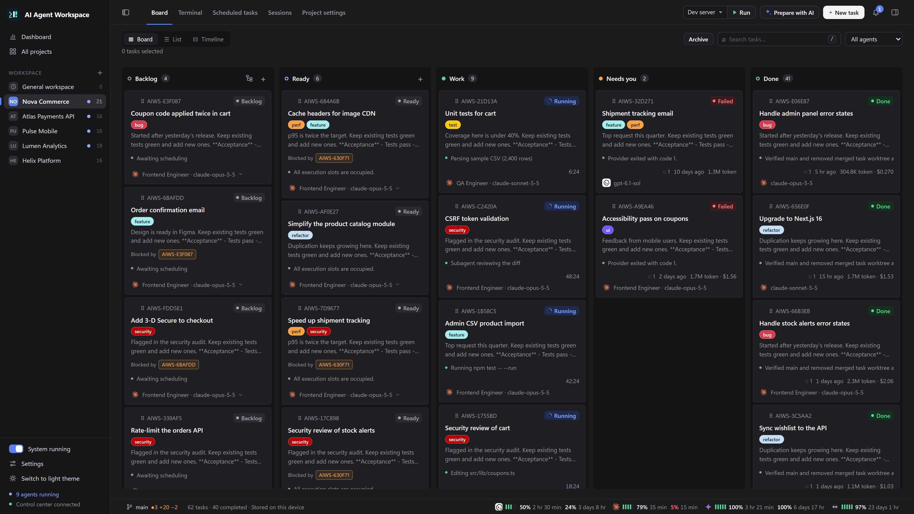
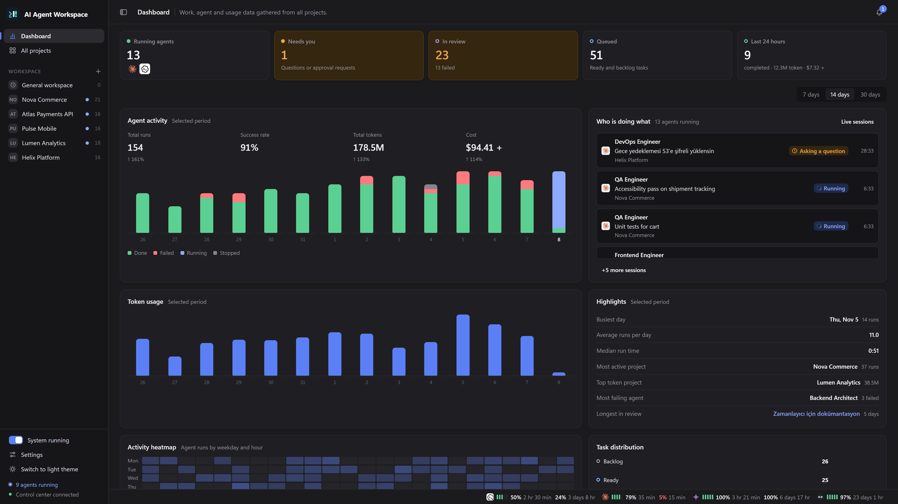

The board is where you create, order and follow tasks. This page covers the project views, the task form, dependencies, bulk actions, tags, milestones and the cross-project screens.



## Project views

Every project has the tabs **Board**, **Terminal**, **Scheduled tasks**, **Sessions** and **Project settings**. Inside **Board** you switch between three views of the same tasks:

| View | Use it for |
|---|---|
| **Board** | Kanban columns: Backlog, Ready, Work, Needs you, Review, Done. Drag cards between columns. |
| **List** | A sortable table of the same tasks, including a milestone column. |
| **Timeline** | Tasks laid out on a time scale. |

The toolbar has task search (press `/` to focus it), an agent filter, a milestone filter and the **Archive** button. Press `N` for a new task.

A card shows the task ID, status, title, tags, a description preview, its **Blocked by** links, the latest activity line, run count, age, token usage and cost, and the agent and model.

## Creating a task

Click **New task**. The window title includes the project name. The title and description are visible first; everything else is under **Advanced options**.

| Field | Notes |
|---|---|
| Title, description | The description is the instruction for this run. Write acceptance criteria here. |
| **Agent profile** | A reusable agent. The task inherits its provider, model and terminal mode unless you override them. |
| Provider, model | Leave on automatic to inherit from the agent or the default provider. **Custom model…** accepts any model ID. |
| **Agent interface** | Stream or the real CLI terminal. See [Core Concepts](Core-Concepts#stream-and-terminal-modes). |
| **Priority** | High, Medium, Low (3, 2, 1). Higher runs first among tasks you have not ordered by hand. |
| **Blocked by** | Tasks or issues that must be done first. |
| **Source branch** | The branch the task branch is created from. Defaults to the project's main branch. |
| **Scheduled start** | Earliest start time for a Ready task. See [Schedules and General Workspace](Schedules-and-General-Workspace). |
| Tags, milestone, skills, workflow | Described below and in [Agents, Skills and Workflows](Agents-Skills-and-Workflows). |
| **Account** | Which Claude Code account runs the task, when several are configured. See [AI Providers](AI-Providers). |

Confirm with **Create task**; when editing, the button is **Save changes**. A task created in **Ready** starts on its own; one created in **Backlog** waits.

### The description editor

The description uses a Markdown editor (EasyMDE) with formatting, lists, links and a safe preview.

- **Images:** paste with Ctrl+V, drag and drop, or use the **Image** button. PNG, JPEG, GIF and WebP are accepted, up to 10 MiB per file. Images are stored in the control service's data directory and the description stays Markdown.
- When a run starts, images from the description (and image attachments of a linked GitHub issue) are prepared in the run's `input/images` folder, at most 20, and the agent prompt contains their local paths.
- **File mentions:** type `@` after a space to search files and folders in the project, in all subfolders. Use the arrow keys and Enter to insert the project-relative path. On a folder, Tab writes `@folder/` and lists its contents. Esc closes the search.

### Attaching files

Open the **Files** panel with the button on the right of the header. It shows the project folder as a tree (folders first, `.git` hidden, Git-ignored entries dimmed).

- Drag a file or folder into the task window to insert its relative path into the description.
- Drop a file or folder onto a card of the same project to attach it to that task. Attached files appear as name chips on the card; remove one with ×.
- Paths are stored relative to the project root, at most 50 per task. Absolute paths and `..` are rejected. The list is given to the agent as context; file contents are not copied.

## Dependencies with Blocked by

**Blocked by** does not load a checklist of every task. Type a title, a local task ID or `#issue` number and the server searches for it.

- A dependent Ready task starts only after every blocker is **Done**. Review does not count.
- In a GitHub-connected project you can pick a repository issue that is not on the board. It becomes a read-only blocker: its title and open/closed state are tracked, the issue itself is never modified and no agent runs for it.
- Cycles and dependencies on tasks in another project are rejected.

```powershell
aiws control tasks search "#123" --project project_ID
aiws control tasks create project_ID "Add checkout tests" --blocked-by "task_LOCAL,#123" --priority 3
aiws control tasks update task_ID --depends-on ""
```

## Selecting and moving many tasks

| Action | How |
|---|---|
| Select single tasks | Ctrl/⌘ + click a card or row |
| Select a range | Shift + click from the last selection |
| Select a whole column | Click the column header; click again to deselect |
| Select all visible rows (List) | **Select all** |
| Clear | **Clear selection**, or Escape while no detail panel is open |

With tasks selected you can:

- Drag one selected card to another column to move them all, or choose a target status and click **Move selected**.
- Choose **Work · start agent** to start runs. Tasks that are already running, waiting or paused do not get a second run. Capacity and dependency checks are applied on the server.
- **Archive selected**. Archiving keeps the status, dependencies and conversation history. Archived Ready tasks are not started. The **Archive** button shows archived tasks; **Restore from archive** brings selected ones back.
- Move the selection to a milestone.

Tasks that succeed are deselected; tasks that fail stay selected with their error message.

## Reordering the Ready column

Drag cards up and down inside **Ready** to set the execution order. See [Core Concepts](Core-Concepts#the-ready-queue) for how the queue uses it.

## Tags

Tags belong to a project and are managed under **Project settings → Tags**: add, rename, recolor, delete. Rules match GitHub issue labels: a name of up to 50 characters (unique, case-insensitive), a six-digit hex color and a description of up to 100 characters.

- Adding an unknown tag in the task details creates it in the project.
- Renaming updates every task. Deleting removes the tag from tasks.
- Tags narrow agent selection only when an agent declares them as a capability. A `bug` tag that no agent declares does not block a task.
- In a GitHub-connected project, tags sync with repository labels in both directions. See [GitHub Integration](GitHub-Integration).

## Milestones

Milestones mirror GitHub milestones: a title, an optional due date, a description and an open/closed state. **Project settings → Milestone** lists them with a progress bar and due date, and lets you edit, close, reopen, delete or **Show tasks**.

- A project has a **current milestone**. New tasks without an explicit milestone are added to it. **Unset current** makes new tasks start without one.
- Change a task's milestone in the task form (**Advanced options → Planning**), in the task details, or for a selection on the board.
- Deleting a milestone keeps its tasks.

```bash
aiws control milestones create project_ID "v1.0" --due 2026-12-31 --description "First release" --current
aiws control milestones assign project_ID milestone_ID task_A,task_B
aiws control tasks list --project project_ID --milestone milestone_ID
```

## Working with a single task

Click a card to open the detail panel on the right (about 45% of the window, resizable by dragging its left edge, or full screen). It has the tabs **Chat**, **Agent Console** and **Information**. See [Agent Console and Sessions](Agent-Console-and-Sessions).

| Action | What it does |
|---|---|
| **Restart** | Appears when the last run failed, was interrupted or was stopped. Starts a new run in the same workspace with the task's settings; earlier runs are kept. In a workflow only the failed stage is retried. |
| Send a new instruction | On a finished task, a message in **Chat** resumes the same provider session in a new run. |
| Move back to Ready | Tasks in Review or Done can be dragged back to Ready; the existing session is verified and resumed. |
| **Fork** | Creates an independent Backlog task that carries the history. The source task is not changed. |
| **Continue with another agent** | Hands the task to a different agent or provider on the same branch. See [AI Providers](AI-Providers). |
| **Delete** | Removes the local task. Stop active work first and remove **Blocked by** references to it. A linked GitHub issue is not deleted or closed. |

## All projects

**All projects** in the sidebar has three tabs:

- **Board** shows every project's columns under one fixed header; each project is a collapsible row.
- **Live sessions** lists all running sessions as cards, including Codex and Claude Code sessions started outside AIWS on the same machine (read-only).
- **Terminal** shows the project terminals and task sessions you pick from the **+** menu, from all projects in one workspace.

## Dashboard



The **Dashboard** gathers data from all projects:

- Status tiles: running agents, items that need you, tasks in review, queued tasks, the last 24 hours.
- For a selectable period of 7, 14 or 30 days: daily agent runs with the change from the previous period, success rate, token usage and cost.
- Highlights: busiest day, median run time, most active project, top token project, most failing agent, longest task in review.
- A weekday-by-hour activity heatmap, task and provider distribution, a "who is doing what" list, a project table and an agent summary.

Run time is computed from active working time and does not grow while a run is paused.

## Related pages

- [Core Concepts](Core-Concepts)
- [Planning with AI](Planning-with-AI)
- [Agent Console and Sessions](Agent-Console-and-Sessions)
- [Terminals, Files and Voice](Terminals-Files-and-Voice)
- [Git, Worktrees and Merging](Git-Worktrees-and-Merging)
- [CLI Reference](CLI-Reference)
