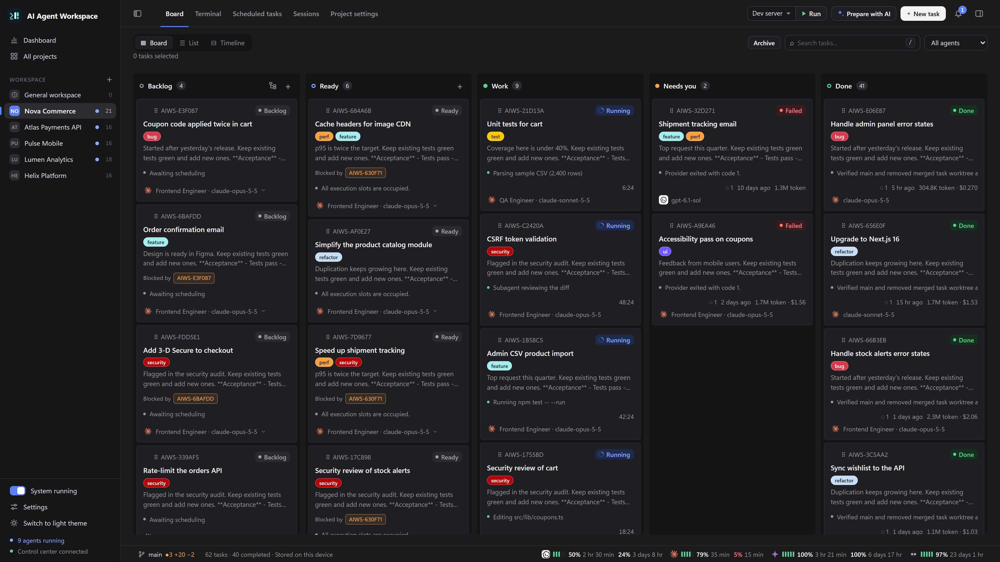
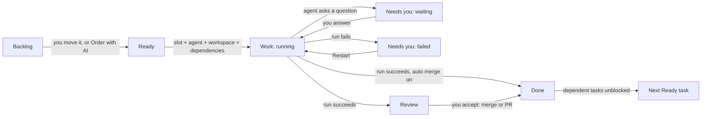

AI Agent Workspace (AIWS) is a local control center: you describe work as tasks on a Kanban board, and coding agents (Codex, Claude Code, OpenCode and others) pick those tasks up and run them on your machine. This page explains the vocabulary used everywhere else in the wiki.



## The building blocks

| Concept | What it is |
|---|---|
| **Project** | A folder on the machine that runs the control service, usually a Git repository. It has its own board, terminals, schedules, sessions and settings. |
| **General workspace** | A built-in project that is not tied to a folder you choose, to Git or to GitHub. Use it for research, reports and reminders. See [Schedules and General Workspace](Schedules-and-General-Workspace). |
| **Task** | One card on the board: a title, a Markdown description and optional settings (agent, provider, model, tags, priority, dependencies). |
| **Run** | One real execution of a task: a provider CLI process (or Docker container) with its own output, events and questions. A task can have many runs. |
| **Agent** | A reusable working profile: name, provider and model, instructions, context and default skills. It is a local profile, not a cloud resource. |
| **Skill** | A `SKILL.md` package with optional resource files that is handed to the agent at run time. |
| **Workflow** | Named, sequential stages, each assigned to an agent. The task is handed from one stage to the next automatically. |
| **Schedule** | A rule that creates a Ready task at given times (once, at intervals, daily, weekly, monthly or cron). |

Agents, skills and workflows are covered in [Agents, Skills and Workflows](Agents-Skills-and-Workflows).

## Task statuses and board columns

A task is always in one of nine statuses. The board groups them into columns:

| Board column | Statuses shown | Meaning |
|---|---|---|
| **Backlog** | `backlog` | Parked. Never starts on its own. |
| **Ready** | `ready` | Queued. Starts automatically when a slot, an agent and the workspace are available. |
| **Work** | `running`, `paused` | An agent process is active or suspended. |
| **Needs you** | `waiting`, `failed` | The agent asked a question or needs approval, or the run failed. |
| **Review** | `review` | The run finished successfully and waits for you to check the result. |
| **Done** | `completing`, `done`, `cancelled` | Being delivered (shown as **Completing** while the merge and cleanup run), delivered, or stopped. |

Things worth knowing:

- You do not set a task to `running` by editing it. Active statuses are reached by starting a real run; use the run controls (pause, resume, stop) while it is active.
- A successful process exit moves the task to **Review**. Exit code 0 does not prove the work is correct, so you move it to **Done** yourself, unless automatic merge is enabled, in which case a successful task goes straight to **Done** (see [Git, Worktrees and Merging](Git-Worktrees-and-Merging)).
- While a merge or pull request is being finished the task sits in **Done** marked as completing, and still holds its execution slot.

## The Ready queue

**Ready means "run this".** There is no separate start button to remember: the scheduler checks the queue every second and starts whatever can start.

A Ready task starts when all of these hold:

1. **A concurrency slot is free.** The limit is a global setting (`aiws control settings set --max-concurrent 3`).
2. **A suitable agent is free.** An unassigned task gets an idle agent that matches its provider and capability tags.
3. **The workspace is available.** Two agents never run in the same working folder at once. With Git worktrees enabled per project, every task gets its own folder and branch, so tasks run in parallel.
4. **All dependencies are delivered.** Every task listed under **Blocked by** must be `done`. `review` does not count.
5. **Its scheduled start time, if any, has passed.**

Ordering:

- The Ready column is processed top to bottom. Drag cards inside the column to change the order.
- Tasks you have not ordered by hand come after the ordered ones, higher priority first, then oldest first.
- A task that cannot start is skipped and the next one is tried. The card shows the reason, for example "All execution slots are occupied."
- Continuing a finished task while all slots are busy does not fail: the task goes to Ready and takes the first free slot, ahead of other Ready tasks.

Dependency cycles and dependencies on tasks in another project are rejected. To keep a task from running, leave it in **Backlog**.

## The System running switch

The **System running** switch at the bottom of the sidebar controls whether new work starts, across all projects.

- Turn it off and running tasks, including their remaining workflow stages, finish normally. The label shows **Stopping…** meanwhile, then **System stopped**.
- Turn it on and Ready tasks continue.
- The off state survives restarting the application. Schedules do not create tasks while the system is stopped.

## Stream and terminal modes

Each run uses one of two interfaces:

| Mode | What runs | Completion | Sending input |
|---|---|---|---|
| **Stream** | The provider's non-interactive mode (for example `codex exec --json`, `claude --print`). Output is parsed into messages, tool calls and file changes. | Automatic when the process exits. | Your instruction is queued and applied in a follow-up turn. |
| **Terminal (PTY)** | The provider's real interactive CLI in a pseudo-terminal, rendered with xterm.js (ConPTY on Windows). | The agent calls `aiws control complete`, or you complete it from the UI. A silent terminal is not a finished task. | Keystrokes go straight to the real CLI. |

New Codex and Claude Code profiles suggest the real CLI terminal; the task form's **Agent interface** field lets you choose explicitly. The mode of an active run cannot be changed. Details are in [Agent Console and Sessions](Agent-Console-and-Sessions).

## Questions and approvals

Agents can ask you something instead of guessing:

```bash
aiws control ask "Should the API response stay backward compatible?"
aiws control ask "Do you approve this migration?" --approval
```

The task moves to **Needs you**, a notification appears in the top bar, and the agent continues once you answer in the task conversation (or, for GitHub-linked tasks, in an issue comment).

## The journey of a task



1. The task is created in **Backlog** or **Ready**.
2. In Ready, the queue starts it: the worktree and branch are prepared, skills and the prompt are written, and the provider CLI is launched.
3. Output is recorded as run events and streamed to the UI.
4. If the agent asks a question, the task waits for your answer.
5. When the run ends, the task moves to Review, or to Done when automatic merge is on.
6. Delivery merges the branch or the pull request and cleans up. Only then do dependent tasks start.

## Where data lives

Everything is stored on the machine that runs the control service, by default in `~/.aiws/control` (SQLite database, settings, run files, the General workspace folder). Only one service opens a data directory at a time. GitHub is optional; see [GitHub Integration](GitHub-Integration).

## Related pages

- [Quick Start](Quick-Start)
- [Board and Tasks](Board-and-Tasks)
- [Planning with AI](Planning-with-AI)
- [Agents, Skills and Workflows](Agents-Skills-and-Workflows)
- [AI Providers](AI-Providers)
- [Agent Console and Sessions](Agent-Console-and-Sessions)
- [Git, Worktrees and Merging](Git-Worktrees-and-Merging)
