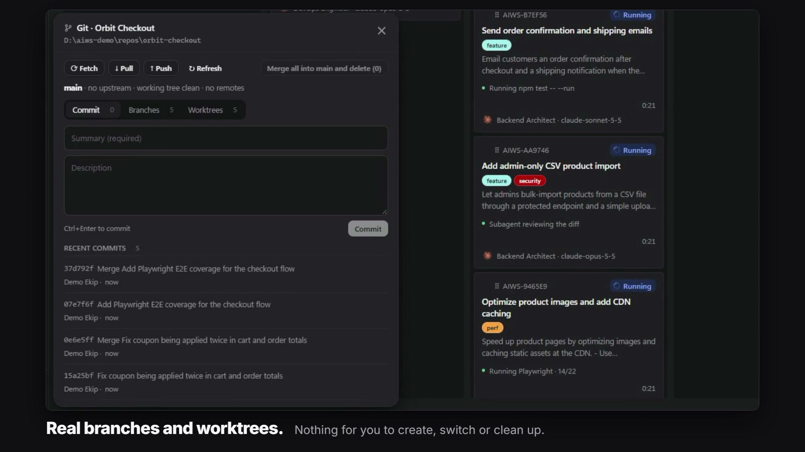

Each task gets its own branch, and with worktrees enabled its own folder, so agents can work in parallel without touching each other's files. When a task succeeds, AIWS delivers it to your main branch by a local merge or a pull request and cleans up after itself.



Git is optional. A plain folder works as a project; it just has no branches, worktrees or merging.

## How a task uses Git

1. **Source branch.** A new task starts from the project's **Default main branch** (default `main`). The task form's **Source branch** field lists local and `origin` branches if one task should start elsewhere.
2. **Task branch.** When the task starts, AIWS creates `aiws/<task-id>` from that source and works there. A branch that exists only on the remote is taken from its `origin` tracking ref. Fetch first if you need the latest remote state.
3. **Same branch for the whole task.** Retries, workflow stages and follow-up instructions reuse the task's branch and workspace.

```powershell
aiws control projects update project_ID --default-branch release
aiws control tasks create project_ID 'Fix cart rounding' --base-branch feature/source
```

## Worktrees

Without worktrees, a task switches the project's own checkout to `aiws/<task-id>`. Only one agent can then work in that folder at a time, and you should commit or stash your changes before switching tasks.

Turn on **Run tasks in separate Git worktrees** in **Project settings** (off by default, per project) and choose the main branch. From then on each new task runs in its own persistent worktree under the control data directory, and separate tasks run concurrently.

```sh
aiws control projects branches <project-id>
aiws control projects update <project-id> --use-worktree true --main-branch main
```

- Turning the setting off affects new tasks only. Existing worktree tasks keep their workspace and merge target.
- Sessions imported or resumed from outside AIWS keep their original folder.

### Dependencies in a new worktree

A new worktree contains only tracked files, so it has no `node_modules`. Before a native agent starts, AIWS links the main checkout's `node_modules` into every folder where all of these hold:

- `package.json` is tracked,
- the lock file (`package-lock.json`, `npm-shrinkwrap.json` or `yarn.lock`) matches the main checkout,
- the folder has no install yet,
- every `dependencies` and `devDependencies` package is installed in the main checkout.

The link is a junction on Windows and a relative symlink elsewhere. An empty or partial main install is not linked; the agent installs that folder itself. pnpm and Yarn PnP installs are left to the agent. Agents are told to delete the link, not its contents, before changing dependencies.

## Merge method

The merge method (**Pull request (PR) / branch merge**) in the general settings picks how finished tasks reach main. A project's Git settings can inherit or override it.

| Method | What happens |
|---|---|
| Pull request (default) | The task branch is committed and pushed to `origin`, and a pull request linked to the task is created. Needs a GitHub remote. |
| Direct branch merge | Task changes are committed, the latest local main is merged into the task branch, then main is fast-forwarded to the result. Nothing is pushed. |

Worktree pull requests use a merge commit that keeps history, so the repository must allow that method.

For a direct merge the target workspace must be clean and the task process must have exited.

## Automatic merge

The **Automatic merge** setting exists per project and can be overridden per task.

- **On:** a successful task moves straight to **Done** after its last workflow stage, and the merge runs in the background.
- **Off:** the task waits in review. Moving it to **Done** yourself requests the merge.

With pull requests, GitHub's own checks, reviews and branch protection are never bypassed. The pull request is merged once they pass, using GitHub auto-merge when the repository supports it.

```powershell
aiws control projects update project_ID --auto-merge true
aiws control tasks update task_ID --auto-merge inherit
```

## The Completing state

An agent finishing its work is not the same as the work being delivered. While a merge is in progress the task sits in the **Done** column with the status **Completing**. It keeps its execution slot until all of this is finished:

- pull request checks,
- the merge into main,
- verification of local main,
- cleanup of the worktree and the local and remote branches.

Tasks waiting in review also keep their slot. If a step fails, the task becomes failed and can be completed again after the problem is fixed. Tasks that depend on this one start only after it has been delivered successfully.

If you merged the task branch by hand, AIWS verifies that the task's commit is on `origin` and on local main and then treats the task as delivered without a new pull request.

## Conflicts

A conflict never leaves main half merged; it stays in the task worktree.

For AI providers, AIWS resumes the session that did the work and gives it a focused instruction: resolve and verify the conflicts, commit on the task branch, integrate main again. Then the merge is retried. If main moved on and conflicts again, the cycle repeats. These recovery runs respect the concurrency limit and the system pause switch.

Tasks that run a custom command keep their conflicts for you to resolve by hand.

## Cleanup

After a successful merge, AIWS removes the task worktree and its local `aiws/<task>` branch. Copies pushed to a remote are deleted only when they are fully contained in main. When a task pull request is confirmed merged, its head branch is deleted on GitHub; the default branch is never deleted.

Merge metadata and the conversation are kept. A failed cleanup is recorded and retried in the background without undoing the merge. Continuing a cleaned-up task recreates its worktree at the same path from the latest merge target.

## Git panel

With a project open, the Git button at the left of the bottom bar shows the current branch, commits to push (↑) and pull (↓), uncommitted changes (●) and a conflict warning (!). Click it to open the panel.

| Control | What it does |
|---|---|
| **Fetch** | Fetches all remotes and prunes deleted remote branches |
| **Pull** | Fast-forward only. A diverged branch shows an error instead of starting a merge |
| **Push** | Pushes the current branch. A branch without upstream is pushed to `origin` with upstream set |
| **Commit** tab | Commits every change in the main workspace, untracked files included, with a required summary and optional description. Ctrl+Enter commits. Lists recent commits |
| **Branches** tab | Each local branch with upstream state, commits ahead of and behind main, last commit, worktree and linked task. Click the task to open it |
| **Worktrees** tab | Each worktree with branch, path, uncommitted changes, linked task and unresolved conflict files |

Network commands never prompt for credentials; Git authentication must already be set up.

### Merge into main and delete

**Merge into main and delete** on a branch is confirmed with a second click.

- **Task branch:** uses the same path as completing the task. The worktree, local branch and merged remote copy are removed and the task becomes Done. On conflict the task's agent is started to resolve it.
- **Branch without a task, no conflict:** merged in the main worktree, then deleted.
- **Branch without a task, with conflict:** main is not touched. AIWS creates a task named **Merge <branch> into main** that resolves the conflict in a separate worktree; after it succeeds both branches are deleted.

Worktrees with uncommitted changes and remote branches that contain commits missing from main are not deleted; they are reported as warnings. Only one Git operation runs per project at a time.

## Related pages

- [Board and Tasks](Board-and-Tasks)
- [GitHub Integration](GitHub-Integration)
- [Core Concepts](Core-Concepts)
- [Agent Console and Sessions](Agent-Console-and-Sessions)
- [Troubleshooting](Troubleshooting)
