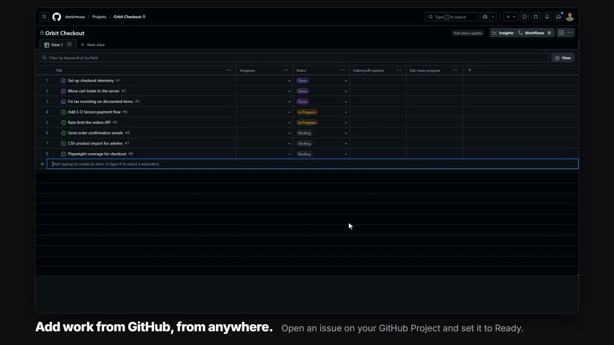
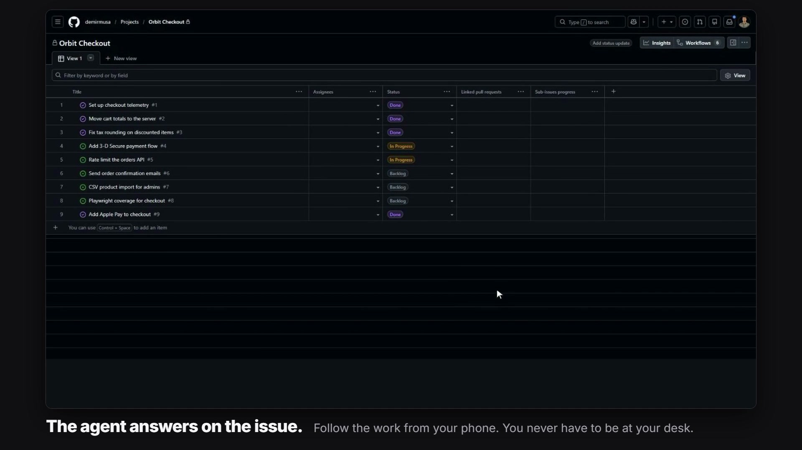

GitHub is optional. Without it, projects and tasks live only on your machine. Connect a project to a GitHub Projects v2 board and its tasks sync both ways with real issues, so you can add work, answer agents and read results from GitHub, including from your phone.



This integration targets github.com. GitHub Enterprise Server is not supported.

## Connect a project

You do not type an owner or a project number. AIWS reads the Git remote of the project folder (`origin` first) and uses your existing `gh auth` session.

1. Open **Project settings** and go to the GitHub section.
2. **Check GitHub access** shows the account and any missing `repo` or `project` scopes. **Grant GitHub access** opens `gh auth refresh -s repo,project` on this computer (or `gh auth login -w -s repo,project` when you are not signed in).
3. Pick one of the Projects v2 boards AIWS found, or choose to create a new board.
4. Save. Missing AIWS statuses are added to the board's Status field; existing options keep their id, color and description.

Discovery is read-only: it creates no issue, pull request or project.

### No GitHub repository yet

If the folder has no GitHub remote, choose **Create and connect a new GitHub repository and Project**. On save AIWS:

- runs `git init` if the folder is not a repository,
- creates the repository (private by default),
- adds the `origin` remote (`github` if `origin` already points elsewhere),
- pushes the current branch if it has commits,
- creates a Projects v2 board and links it to the repository.

### From the CLI

```powershell
aiws control github status
aiws control github authorize
aiws control projects detect D:\GitHub\my-app
aiws control projects connect project_ID --number 12
aiws control projects connect project_ID --create-project --project-title 'App development'
aiws control projects connect project_ID --create-repository --repository-name my-app
aiws control projects sync project_ID
```

## Tokens and permissions

The token is resolved in this order and stays on the backend. You never enter a GitHub token in the UI.

1. A token given to the service
2. `AIWS_GITHUB_TOKEN`
3. `GH_TOKEN`
4. `GITHUB_TOKEN`
5. `gh auth token`

| Token type | Needs |
|---|---|
| Classic PAT | `repo` and `project` (`read:project` is enough for read-only queries) |
| Fine-grained token or GitHub App | Repository **Issues** read/write, **Projects** read/write for the user or organization, access to the repository |

Organization SSO and policies still apply. The Docker image has no `gh`; pass the token through the environment there.

## What syncs

1. A local task without an issue gets one: the issue is created in the repository, added to the board and its status is set.
2. Issue cards on the board that belong to the connected repository become local tasks. Pull requests, draft issues and cards from other repositories are skipped.
3. Title, body and status are updated in both directions. Closing the issue makes the task done; marking the task done or cancelled closes the issue.
4. Per field, a local change made since the last sync wins. Fields you did not change locally are taken from GitHub.
5. Each issue body carries a hidden `<!-- aiws-task:... -->` marker, so a partly failed sync finds the same issue again instead of creating a duplicate.

AIWS polls every 30 seconds by default. Each poll is one cheap query that checks whether the board, issues or milestones changed; a full sync runs only when something changed, or at least every 5 minutes. No webhook and no open port are needed.

```powershell
aiws control settings set --auto-sync-seconds 60   # 0 turns automatic sync off
```

Moving a card on GitHub does not stop a running process; the local active state of a run is kept.

### Status mapping

| AIWS status | Board option |
|---|---|
| backlog | Backlog |
| ready | Ready |
| running | In progress |
| waiting | Waiting |
| paused | Paused |
| review | In review |
| completing | Completing |
| done | Done |
| failed | Failed |
| cancelled | Cancelled |

Standard boards with Todo / In Progress / Done work through fallback names, but several AIWS statuses then share a column. For a custom mapping:

```powershell
aiws control projects connect project_ID --repository my-org/my-repo --owner my-org --owner-type organization --number 12 --statuses '{"backlog":"Todo","ready":"Ready","running":"In Progress","review":"In Review","done":"Done"}'
```

`owner` and `number` identify the board: `https://github.com/orgs/my-org/projects/12` is organization `my-org`, number `12`.

### Labels

Labels are defined per project in **Project settings** and follow GitHub's rules (name up to 50 characters, six-digit hex color, description up to 100 characters).

- When connecting, you can import the repository's labels into the project (on by default) and export the project's labels to the repository.
- Later, import updates color and description of labels with the same name; export creates missing repository labels and never deletes labels that exist only on GitHub.
- During sync, task labels and issue labels follow each other in both directions.

A label restricts agent selection only if an agent declares it as a capability.

### Milestones

Project milestones mirror repository milestones: title, optional due date, description, open or closed. Every sync matches them both ways by title, creates missing ones on either side and applies the same "local change wins per field" rule. A task's milestone follows the issue's milestone. Disconnecting keeps the milestones locally.

```bash
aiws control milestones create project_ID 'v1.0' --due 2026-12-31 --current
aiws control milestones assign project_ID milestone_ID task_A,task_B
```

## Manage from GitHub

While the desktop app is running on your computer, you can run the project from GitHub. Agents still work on that computer.



| On GitHub you | AIWS does |
|---|---|
| Open an issue | Adds it to the board as a Backlog task |
| Open an issue containing `/ai` in title or body | Makes it **Ready**; it runs when a slot is free |
| Move a card to Ready | Starts the task |
| Comment while the agent is waiting on a question | Uses the comment as the answer; the agent continues |
| Comment with `/ai` and a request | Sends it to the task: queued if running, resumes the same session if finished, makes the task Ready if it never ran |

What comes back:

- When a run of a linked task finishes, the result is posted as an issue comment: the agent's final answer left with `aiws control reply` (or `aiws control complete --reply`), otherwise its last message.
- Questions asked with `aiws control ask` are posted on the issue too. Images attached with `--image` are committed to the `aiws-attachments` branch and shown in the comment. Your reply comment goes to the agent word for word, so you can answer with new instructions as well as yes or no. Native CLI dialogs of terminal runs (for example a permission menu) are posted with their numbered options: reply with a number to pick one, or with any other text to dismiss the dialog and type that text into the agent's terminal.
- Accepted comments get a 👀 reaction. Requests that cannot start get 😕 and an explanatory comment.

**Who is allowed.** Only the repository owner, organization members and collaborators can open work, answer questions or trigger the AI. Other comments are ignored and logged. AIWS's own comments carry a hidden marker and are never read as requests. Issues and comments from before the connection are not processed.

**Running in the background.** Closing the desktop window sends the app to the system tray; polling and agents continue. The tray menu can start the app hidden at login. Quit from the tray to stop everything, including running agents.

**Trigger word.** Change `/ai` under **Settings → GitHub AI trigger** or with `aiws control settings set --github-trigger /ai`. A trigger of the form `@name` can notify a real GitHub user with that name, which is why the default is `/ai`.

## Pull requests and automatic merge

With the pull request merge method, AIWS pushes the task branch and opens a pull request linked to the task. Automatic merge can be set per project and overridden per task.

A pull request is merged only if it carries the task's marker or linked issue, comes from the same repository, targets the configured main branch, is open and not a draft, and its HEAD is the one AIWS recorded. Branch protection, required checks and reviews are not bypassed; when they are still pending and the repository supports it, GitHub's own auto-merge is enabled.

```powershell
aiws control projects update project_ID --auto-merge true
aiws control tasks update task_ID --pull-request 42 --head-sha EXPECTED_SHA --auto-merge true
```

Details: [Git, Worktrees and Merging](Git-Worktrees-and-Merging).

## Not synced, and other limits

- Assignees, custom Project fields and card order are not synced.
- Deleting a linked task does not delete or close the issue. The issue goes on an ignore list so it is not imported again; changing or re-creating the connection resets that list.
- Removing the connection keeps local tasks and deletes nothing on GitHub.
- **Download all issues** in the project settings imports every issue of the repository as tasks without needing a board, and writes nothing to GitHub.
- Do not run two control centers as active executors of the same GitHub project.
- If the repository also uses the [GitHub Actions Runner](GitHub-Actions-Runner), update it (`aiws sync`, then `aiws up`) before connecting, so the runner skips issues owned by the control center.

## Related pages

- [Git, Worktrees and Merging](Git-Worktrees-and-Merging)
- [Board and Tasks](Board-and-Tasks)
- [GitHub Actions Runner](GitHub-Actions-Runner)
- [Security](Security)
- [CLI Reference](CLI-Reference)
- [Troubleshooting](Troubleshooting)
