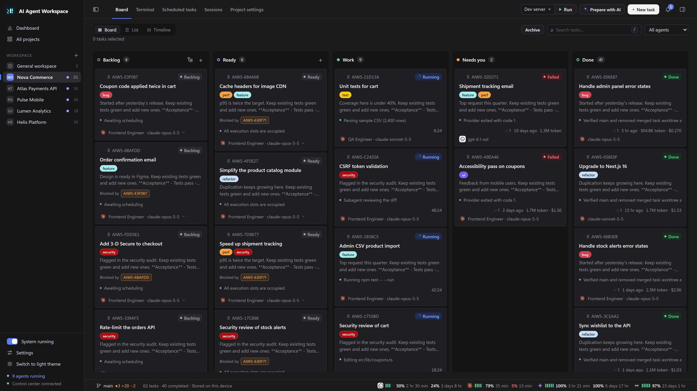

Welcome to the **AI Agent Workspace** (AIWS) documentation. AIWS is a local-first Kanban board and desktop app that runs your coding agents (Claude Code, Codex, OpenCode, Antigravity, GitHub Copilot) in parallel, each task in its own Git branch and worktree, and merges the result for you.

New here? Follow these three pages in order:

1. **[Installation](Installation)**: clone the repository and start the app.
2. **[Quick Start](Quick-Start)**: add a project and run your first task.
3. **[Core Concepts](Core-Concepts)**: how projects, tasks, runs and agents fit together.

## Guides

| Page | What you will find |
| --- | --- |
| [Board and Tasks](Board-and-Tasks) | Board, List and Timeline views; creating, ordering, selecting and archiving tasks; labels and milestones |
| [Planning with AI](Planning-with-AI) | Turning a description into task drafts, and letting an agent order your backlog |
| [AI Providers](AI-Providers) | Supported agent CLIs, models, auto mode, multiple Claude accounts, usage and quota |
| [Agents, Skills and Workflows](Agents-Skills-and-Workflows) | Reusable agent profiles, skill packages, templates and multi-stage workflows |
| [Agent Console and Sessions](Agent-Console-and-Sessions) | Watching a run, answering questions, subagents, resuming and transferring sessions |
| [Terminals, Files and Voice](Terminals-Files-and-Voice) | Project terminals, the file tree and editor, voice dictation |
| [Git, Worktrees and Merging](Git-Worktrees-and-Merging) | Task branches, worktrees, automatic merge, conflicts, the Git panel |
| [Schedules and General Workspace](Schedules-and-General-Workspace) | Scheduled and recurring tasks; work that is not tied to a repository |
| [GitHub Integration](GitHub-Integration) | Two-way sync with GitHub Projects, managing work from your phone, pull requests |
| [Plugins and Themes](Plugins-and-Themes) | Installing and writing plugins; color themes |

## Operations

| Page | What you will find |
| --- | --- |
| [Configuration](Configuration) | Settings, environment variables and where data is stored |
| [Docker Deployment](Docker-Deployment) | Running the control server and agent workers in containers |
| [GitHub Actions Runner](GitHub-Actions-Runner) | The self-hosted runner pipeline (`aiws init` / `aiws up`) |
| [Security](Security) | Trust boundaries, tokens and remaining risks |
| [Troubleshooting](Troubleshooting) | Common problems and how to check them |

## Reference

| Page | What you will find |
| --- | --- |
| [CLI Reference](CLI-Reference) | Every `aiws` and `aiws control` command |
| [HTTP API](HTTP-API) | Endpoints of the control server |
| [FAQ](FAQ) | Short answers to common questions |
| [Development](Development) | Repository layout, tests and contribution rules |

## Two ways to use AIWS

AIWS ships two independent modes in one package:

- **Control center** (this is what most people want): the desktop app or browser UI with the board, live agents, terminals and optional GitHub Projects sync. It needs no GitHub account and no Docker.
- **GitHub Actions runner**: a self-hosted runner you attach to a repository so that issue labels and PR comments start agents inside Docker. See [GitHub Actions Runner](GitHub-Actions-Runner).

Everything in this wiki is about the control center unless a page says otherwise.

## Watch the demo

A 3-minute walkthrough video is at the top of the [README](https://github.com/demirmusa/ai-agent-workspace#readme).
