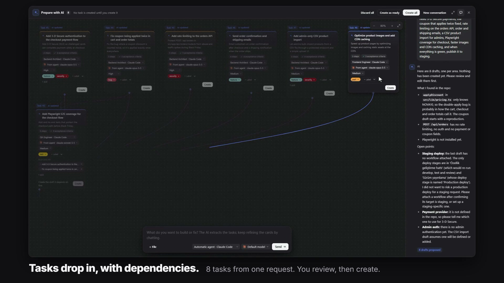

AIWS can turn a plain description of what you want into task drafts, and can order an existing backlog into a dependency tree. In both cases the AI prepares; you decide what is created and what runs.



## Prepare with AI

Click **Prepare with AI** next to **New task**. A panel slides up over the board.

1. Write what you need in the message box at the bottom, in your own words. You do not need to say how to split it.
2. A real provider breaks the request into short, focused task drafts. They appear as cards above the message box.
3. Review the cards. Click one to open the normal **New task** window filled with its values.
4. Create the tasks you want. Nothing exists on the board until you do.

What the drafts contain:

- A title, a description and a priority.
- Tags, when the project has tags.
- An agent, when agent profiles exist. If the project has no tags or agents, those fields are not shown on the card.
- Dependencies between drafts.

Working with the drafts:

- Edit agent, model and priority directly on a card; add or remove tags.
- Keep talking to refine the result. The AI does not touch fields you have edited.
- Ask for one task ("open all of this as a single task") and the work is merged into one draft.
- A task created from a card stays linked to that card; the panel and the other cards remain behind the window.

### The dependency canvas

Drafts are laid out as a tree: a draft with no dependencies is at the top, drafts that depend on it sit side by side below it, and later steps are indented under their own dependencies. A draft with several dependencies is placed under its deepest one; the other dependencies are drawn as dashed lines.

### What it does not do

- The conversation and drafts are stored per project in this browser. No task, run, GitHub issue or permanent planning conversation is created until you create the task.
- Even if you ask the model to "start" something, this flow only returns Backlog drafts. Filling in a form is not permission to run the work.
- Invented agent, skill or workflow IDs, dependencies on another project's tasks, an active or completed starting status and malformed JSON are rejected.

## Read-only planning mode

Planning and drafting run the provider in a read-only mode, whatever the selected profile's normal behavior is:

| Provider | Read-only behavior |
|---|---|
| Codex | Read-only sandbox |
| Claude Code | Plan mode with only the Read, Glob and Grep tools |
| OpenCode | Deny by default, with read tools allowed |
| Docker execution | The project bind mount is also read-only |

A custom command profile cannot be a planner, and the planner does not receive the control API's callback credentials. Provider arguments that widen permissions are not used here, and **Auto mode** does not affect this limit.

The planner uses the default provider unless you pick an agent. See [AI Providers](AI-Providers).

## Order with AI

The tree button in the **Backlog** column header starts **Order with AI**, a work-organizing orchestrator. It does not create tasks. It sets up the ones you already have.

- It runs with the default provider, in the project folder, with access to the control API.
- Its prompt already contains all Backlog tasks (to be organized), the Ready tasks (context only, they are not changed) and the titles of other unfinished tasks, so it has no need to read the repository.
- The prompt forbids reading code, writing code, running commands and doing the tasks' work. The agent only adjusts Backlog tasks:

```bash
aiws control tasks update <id> --depends-on <ids> --priority <n> --status ready
```

- Dependencies are written in the same command that moves a task to Ready, so a task whose prerequisite is unfinished does not start early.
- When it finishes you get a report: the execution tree, the tasks that can run in parallel and the tasks left in Backlog.
- Click the button again while it runs to stop it. Changes made up to that point are kept.

Once tasks are in Ready, the queue runs them in dependency order. See [Core Concepts](Core-Concepts#the-ready-queue).

## From the command line

```powershell
# Same pure draft flow as the UI. Creates nothing.
aiws control projects draft project_ID "Prepare an accessibility task for the search results." --agent agent_PLANNER

# Look up a blocker, then save the reviewed draft explicitly.
aiws control tasks search "#123" --project project_ID
aiws control tasks create project_ID "Edited title" --description "Acceptance criteria..." --priority 3 --blocked-by "task_LOCAL,#123"

# Order the backlog, or cancel a running organizer.
aiws control projects organize project_ID
aiws control projects organize project_ID --cancel
```

### The older `projects plan` command

`projects plan` is kept for compatibility and behaves differently from the UI: it is an explicit create operation. It saves the validated result as tasks, and can create them as Ready when your request clearly says to start the work. The UI never calls this endpoint.

```powershell
aiws control projects plan project_ID "Create an accessibility test task for the search results." --agent agent_PLANNER
aiws control projects plan project_ID "Queue this as ready and hand it to the deploy agent when it is done." --agent agent_PLANNER
aiws control projects conversation project_ID
```

A natural request such as "send it to the server when it is done" becomes a semantic `requestedActions: ["deploy"]` and selects an existing workflow. It is not matched with a keyword regex. See [Agents, Skills and Workflows](Agents-Skills-and-Workflows).

## Tips

- Describe the outcome and the constraints; let the drafts carry the acceptance criteria.
- Define a few agent profiles and tags first. Drafts then arrive with an agent and tags already assigned.
- Use **Prepare with AI** for new work and **Order with AI** for a backlog that grew by hand or came from GitHub issues.

## Related pages

- [Board and Tasks](Board-and-Tasks)
- [Core Concepts](Core-Concepts)
- [Agents, Skills and Workflows](Agents-Skills-and-Workflows)
- [AI Providers](AI-Providers)
- [CLI Reference](CLI-Reference)
