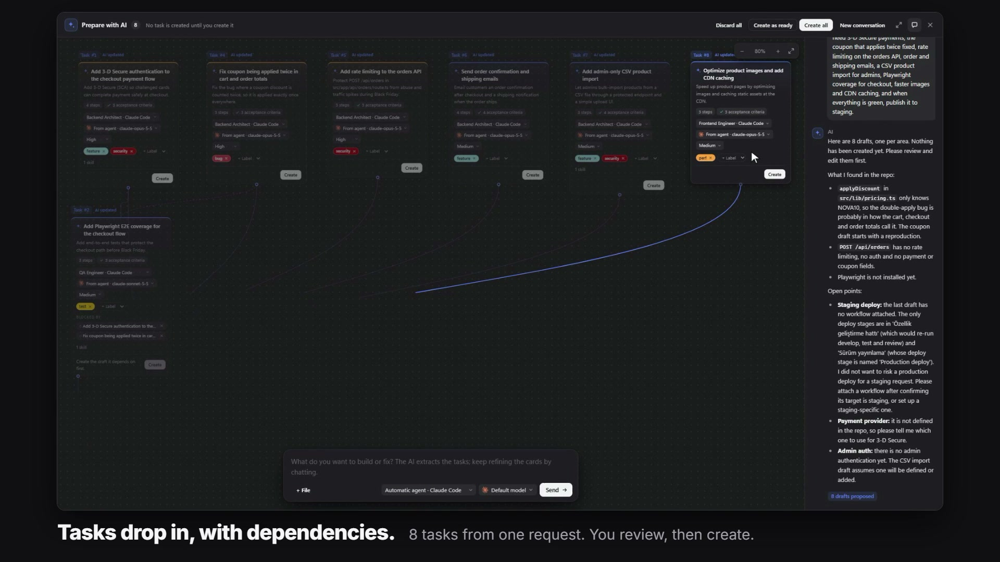
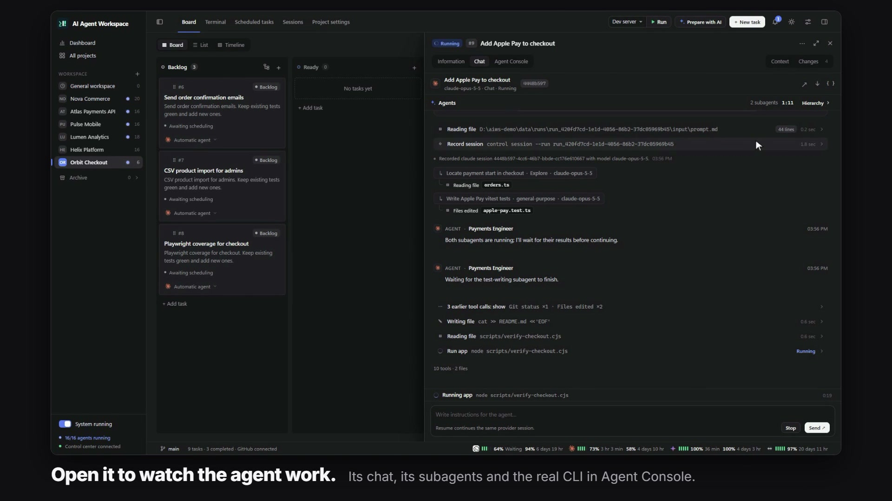
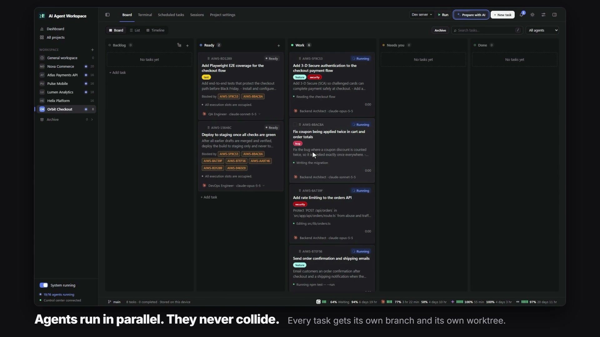

This page takes you from a freshly installed app to a finished, merged task in about ten minutes. If the app is not running yet, start with [Installation](Installation).

## 1. Add a project

A project is a folder on your machine that agents work in, usually a Git repository.

1. In the sidebar, click **+** next to **Workspace** (**New project**).
2. Pick the project folder. The desktop app opens your system's folder picker; in the browser you choose from the folders the server can reach.
3. Give it a name and save.

The project opens on its **Board** tab. Its other tabs are **Terminal**, **Scheduled tasks**, **Sessions** and **Project settings**.

> No repository at hand? Use **General workspace** at the top of the sidebar. It is a shared folder for work that is not tied to a project.

## 2. Create a task

Click **New task**, write a title and describe the work the way you would brief a colleague: what to change, what must keep working, how to verify it. Then create the task. It lands in **Backlog**.

Or let AIWS draft the tasks for you: click **Prepare with AI**, explain the goal in your own words, and review the cards it proposes. Nothing is created until you confirm. See [Planning with AI](Planning-with-AI).



## 3. Start it

Drag the card to **Ready**. Tasks in Ready start on their own as soon as an agent slot is free and everything they depend on is done. You do not press a run button.

The card moves to **Work** and shows what the agent is doing right now.

## 4. Watch and answer

Click the card. A panel opens on the right:

- **Chat** shows the agent's messages, tool calls, file changes and subagents in a readable form.
- **Agent Console** is the agent's real CLI terminal. You can type into it.
- **Information** has the description, status and actions.

If the agent needs a decision, the card moves to **Needs you** and you get a notification. Answer in the task and the agent continues.



## 5. Review and finish

When the agent finishes, the task waits for your review. Look at the changes, send a follow-up instruction in **Chat** if something is missing, and move the card to **Done** when you are satisfied.

If the project uses Git worktrees, moving a task to Done commits its changes, merges its branch into your main branch and removes the worktree. With **Automatic merge** on, a successful task does this without waiting for you. See [Git, Worktrees and Merging](Git-Worktrees-and-Merging).

## 6. Run several tasks at once

To let agents work in parallel on the same repository without touching each other's files:

1. Open **Project settings** and turn on **Run tasks in separate Git worktrees**. Choose your main branch.
2. Raise **Concurrent agents** in **Settings**.
3. Put several tasks in Ready.

Each task now runs on its own `aiws/<task-id>` branch in its own worktree. Use **Blocked by** on a task to make it wait until another one is delivered.



## The same thing from the command line

Everything above is available through the CLI. IDs come from the JSON each command prints.

```bash
aiws control projects create "My web app" --path /path/to/my-app
aiws control tasks create <project-id> "Tidy up the login screen" \
  --provider claude \
  --description "Read the repository instructions, apply the change and run the related tests."
aiws control tasks run <task-id>
aiws control runs list
```

See the [CLI Reference](CLI-Reference).

## Where to go next

| I want to... | Read |
| --- | --- |
| Understand statuses, runs and the queue | [Core Concepts](Core-Concepts) |
| Choose providers and models, use several accounts | [AI Providers](AI-Providers) |
| Give agents a role, background knowledge and skills | [Agents, Skills and Workflows](Agents-Skills-and-Workflows) |
| Run something every morning | [Schedules and General Workspace](Schedules-and-General-Workspace) |
| Add work from my phone | [GitHub Integration](GitHub-Integration) |
| Fix a problem | [Troubleshooting](Troubleshooting) |
