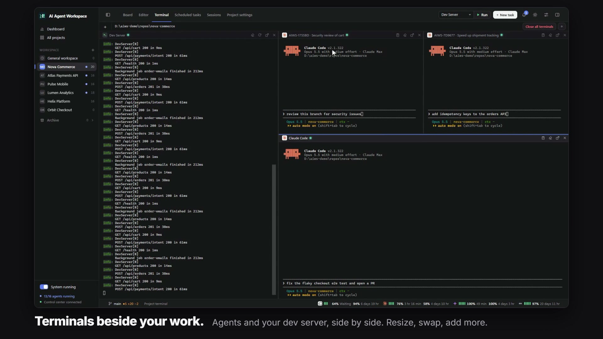
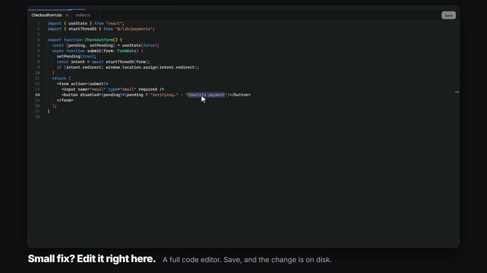

AI Agent Workspace keeps the tools you need around an agent in the same window: project terminals, a file tree with an editor, and dictation into any text field.

## Project terminals

Open a project and choose the **Terminal** tab, then **Open terminal**. A normal shell starts in the project folder: PowerShell on Windows, your login shell elsewhere.



The **+** menu opens other kinds of terminals:

| Kind | What it runs |
|---|---|
| Shell | PowerShell on Windows, `$SHELL` (or `/bin/sh -l`) elsewhere |
| Agent CLI | A provider CLI found on `PATH`, such as Claude Code or Codex, with your saved provider arguments |
| Agent CLI with account | Claude Code under one of your saved accounts. See [AI Providers](AI-Providers) |
| Run script | A shell that runs one of the project's run scripts |

Things to know:

- **Panes.** Terminals sit side by side. Resize them, swap them by dragging, maximize one, or add more. A project can have up to 8 terminals.
- **They stay open.** Terminals live on the server. Switching tabs or reloading the page does not close them. After the control center restarts, each terminal comes back with its output; shells open a fresh prompt and agent terminals resume the same provider session.
- **Agent terminal to task.** A session started in an agent terminal can be converted into a board task later, and the task continues the same session.
- **Closing.** **Close terminal** ends that process; **Close all terminals** ends all of them. Quitting the control center ends every terminal.
- **All projects.** **All projects → Terminal** shows the terminals and opened task sessions of every project in one workspace; the **+** menu asks which project the new terminal belongs to.

Project terminals are not agent runs: they are not scheduled, do not use an execution slot and do not receive run credentials.

### Run scripts

The **Run** button in the project header starts a script you have defined, for example your dev server, in a terminal pane. Define scripts under **Project settings → Run scripts**.

| Field | Notes |
|---|---|
| Name | For example `Dev server` |
| Target | A script file inside the repository (`.ps1`, `.sh`, `.bash`, `.bat`, `.cmd`), an npm script from a `package.json`, or a command line |
| Arguments | Fixed arguments, or ask every time. Parameters of a `.ps1` `param(...)` block are detected |

AIWS suggests script candidates it finds in the repository. A project can have up to 50 run scripts. The last five argument sets per script are remembered, stored encrypted. On Windows, `.sh` scripts need Git Bash.

### Attaching from the CLI

A task run in terminal mode can also be reached from your own terminal:

```powershell
aiws control runs attach run_ID
# Ctrl+] detaches; the agent keeps running.
aiws control runs input run_ID 'New instruction' --enter
aiws control runs resize run_ID 120 40
```

### How it is built

node-pty creates the operating system pseudo-terminal and xterm.js renders it. In the desktop app node-pty runs in a separate system Node process, so `node` must be on `PATH` (or set `AIWS_NODE_BINARY`). On Linux a source install needs Python 3, make and a C++ compiler to build node-pty.

## Files panel

The files button on the right of the header toggles the **Files** panel. It shows the project folder as a tree, folders first. `.git` is hidden, files ignored by Git are dimmed, and changed files carry Git status badges. Drag the panel's left edge to resize it.

| You want to | Do this |
|---|---|
| Reference a file in a task | Drag the file or folder into the task window. Its project-relative path is inserted where you drop it. |
| Attach files to an existing task | Drop them on the task's card. Attached paths show as chips on the card; up to 50 per task. The agent gets the list as context, the contents are not copied. |
| Mention a file while typing | In a task description, type `@` after a space. Search matches file and folder names in all subfolders. Use the arrow keys and Enter to insert the path, Tab to step into a folder, Esc to close. |
| Open a file outside AIWS | Right-click → **Open with default program** |
| Find a folder on disk | Right-click → **Reveal in File Explorer** (**Reveal in Finder** on macOS) |
| Copy a path | Right-click → **Copy path** or **Copy relative path** |
| Create a file | The **New file** button in the panel header, or right-click → **New file…**. Type the name with its extension and the folder (prefilled with the selected folder; typing suggests matching folders). The file is created empty and opens in the editor; an existing file is never replaced. |

The panel stays usable while the **New task** window is open.

### File editor

Clicking a file opens it in the built-in editor (Monaco, the editor behind VS Code). Files open as tabs. An edited tab shows an unsaved marker; **Save** writes the change to disk and confirms with "File saved". Closing a tab with edits asks before discarding them.

Pictures (PNG, JPEG, GIF, WebP, BMP, ICO and AVIF, up to 16 MiB) open as a preview in the same tab instead of the editor. SVG files are text, so they open in the editor.



The editor is meant for small fixes next to the agent's work. For a task, the **Changes** view shows the files that task changed, also after its branch was merged and deleted.

## Images in tasks and terminals

- In a task description, paste with **Ctrl+V**, drag and drop, or use the image button: PNG, JPEG, GIF and WebP up to 10 MiB each. The description stays Markdown.
- When a run starts, images from the description and from the linked GitHub issue are placed in the run's `input/images` folder (up to 20) and the agent prompt lists their paths.
- Pasting an image into a native CLI terminal uploads it and types its path into the input. You still press Enter yourself.

## Voice dictation

Focus any text field and a microphone button appears near the caret. Click it or press **Ctrl + Shift + M** (**Cmd + Shift + M** on macOS) and speak. The text is written where the caret is.

| Key | Effect |
|---|---|
| Ctrl/Cmd + Shift + M | Start or stop listening |
| Esc | Stop listening. Text heard so far is already written |
| Enter | Stop listening and do its normal job: send the message, run the command |
| Shift + Enter | New line; keeps listening |

AIWS has no speech engine of its own. Audio is relayed through the control server to the speech service of an AI provider you are already signed in to. Supported providers are **Claude Code** (default) and **Codex**. Choose one under **Settings → Voice → Dictation provider**.

Dictation works in inputs, text areas, the Markdown editor and terminals. The provider's sign-in stays on the server and is never sent to the browser. The browser asks for microphone permission the first time.

## Related pages

- [Agent Console and Sessions](Agent-Console-and-Sessions)
- [Board and Tasks](Board-and-Tasks)
- [AI Providers](AI-Providers)
- [Git, Worktrees and Merging](Git-Worktrees-and-Merging)
- [Configuration](Configuration)
